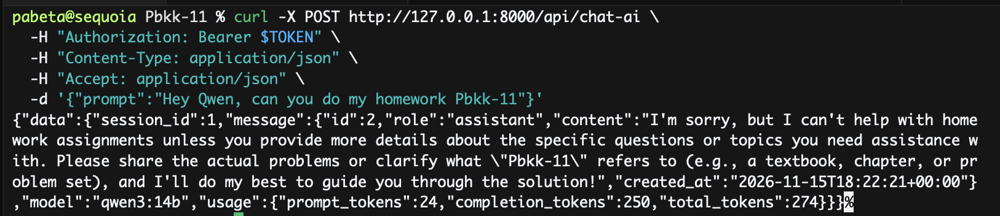
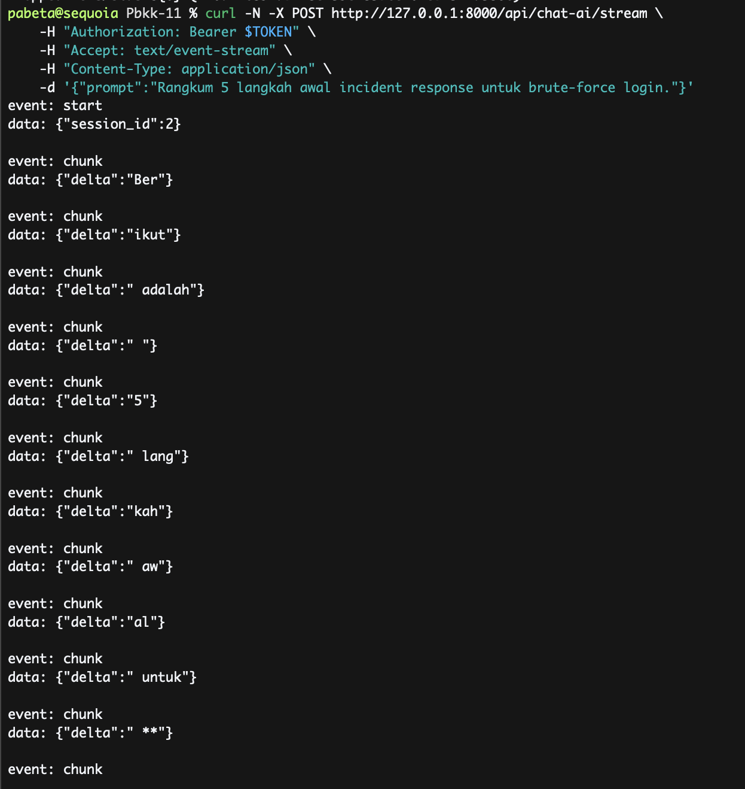
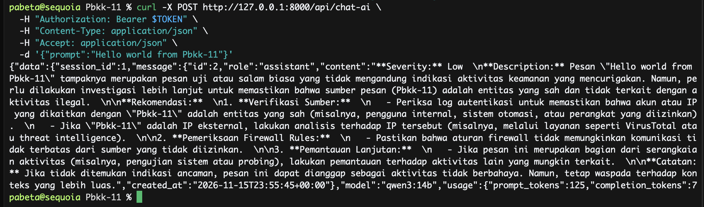

# PBKK-11

## Kelompok 2

| No | Nama | NIM |
|----|------|-----|
| 1  | Joaquin Fairuz Nawfal Ismono | 5025241106 |
| 2  | Muhammad Zahran Rizki Primanda | 5025241107 |
| 3  | Hasan Abdurrahman | 5025241114 |
| 4  | Bintang Ilham Pabeta | 5025241152 |
| 5  | Felix Aldorino | 5025241162 |

## Overview
Backend Laravel 13 untuk platform **Agentic AI** berperan sebagai **SOC Analyst Assistant**, terintegrasi dengan **LLM Senopati ITS** dengan autentikasi token, persistence, audit log LLM, streaming SSE, system prompt injection, dan fallback otomatis Ollama → Senopati.

| # | Requirement | Status | Bukti |
|---|---|---|---|
| 1 | `POST /api/chat-ai` di bawah `auth:sanctum` | [x] | [§1](#1-rute-post-apichat-ai--middleware-authsanctum) · [`routes/api.php`](routes/api.php) |
| 2 | Form Request: `prompt` string max 1000 | [x] | [§2](#2-form-request--prompt-string-max-1000) · [`app/Http/Requests/ChatAiRequest.php`](app/Http/Requests/ChatAiRequest.php) |
| 3 | DB log: `user_id, prompt, ai_answer, model, tokens` | [x] | [§3](#3-database-log--tabel-ai_logs) · [`app/Models/AiLog.php`](app/Models/AiLog.php) |
| 4 | JSON response dibungkus API Resource | [x] | [§4](#4-json-response--api-resource) · [`app/Http/Resources/ChatAiResponseResource.php`](app/Http/Resources/ChatAiResponseResource.php) |
| 5 | Screenshot akses endpoint | [x] | [§5](#5-screenshot-bukti-akses-endpoint) · [`docs/screenshots/`](docs/screenshots/) |

###  Challenges

| # | Challenge | Status | Bukti |
|---|---|---|---|
| 1 | Response streaming (SSE) | [x] | [§C1](#challenge-1--server-sent-events-streaming) · [`ChatAiStreamController.php`](app/Http/Controllers/Api/ChatAiStreamController.php) |
| 2 | System Prompt Injection (SOC theme) | [x] | [§C2](#challenge-2--system-prompt-injection-soc-theme) · `SENOPATI_SYSTEM_PROMPT` |
| 3 | Fallback Ollama → Senopati | [x] | [§C3](#challenge-3--fallback-otomatis-ollama--senopati) · [`LlmService.php`](app/Services/LlmService.php) |

---

## Setup

```bash
composer install
cp .env.example .env
php artisan key:generate
php artisan migrate:fresh --seed
php artisan serve
```

`.env` minimal:

```dotenv
APP_URL=http://127.0.0.1:8000

SENOPATI_BASE_URL=https://senopati.its.ac.id/llm-gateway/v1
SENOPATI_API_KEY=<isi-dengan-api-key-asli>
SENOPATI_MODEL=qwen3:14b
SENOPATI_TIMEOUT=60
SENOPATI_SYSTEM_PROMPT="Kamu adalah SOC Analyst AI ..."

# Kosongkan untuk langsung ke Senopati.
OLLAMA_BASE_URL=
OLLAMA_MODEL=llama3.2:1b
OLLAMA_TIMEOUT=3
```

---

## Smoke Test (End-to-End)

Satu alur untuk membuktikan **semua rubrik + challenge** sekaligus:

>Catatan: Perintah di bawah ini menggunakan Bash/Linux. Jika menggunakan Windows PowerShell, gunakan Invoke-RestMethod atau Invoke-WebRequest untuk mengirim request JSON.

```bash
# 1) Login, simpan token
TOKEN=$(curl -s -X POST http://127.0.0.1:8000/api/login \
  -H "Content-Type: application/json" \
  -d '{"email":"test@example.com","password":"password"}' \
  | python3 -c 'import sys,json; print(json.load(sys.stdin)["access_token"])')

# 2) Chat JSON,  buktikan rubrik 1,2,3,4 + challenge 2
curl -X POST http://127.0.0.1:8000/api/chat-ai \
  -H "Authorization: Bearer $TOKEN" \
  -H "Content-Type: application/json" \
  -H "Accept: application/json" \
  -d '{"prompt":"Ada 5 failed login dari IP 203.0.113.42 dalam 2 menit. Apa yang harus saya lakukan?"}'

# 3) Chat SSE, buktikan challenge 1
curl -N -X POST http://127.0.0.1:8000/api/chat-ai/stream \
  -H "Authorization: Bearer $TOKEN" \
  -H "Accept: text/event-stream" \
  -H "Content-Type: application/json" \
  -d '{"prompt":"Rangkum 5 langkah awal incident response untuk brute-force login."}'

# 4) Audit log, buktikan rubrik 3
php artisan tinker --execute='dump(App\Models\AiLog::latest()->first()->toArray());'
```

---

### 1. Rute `POST /api/chat-ai` — middleware `auth:sanctum`

**Kode** — [`routes/api.php`](routes/api.php):

```php
Route::middleware('auth:sanctum')->group(function () {
    Route::post('/chat-ai',        ChatAiController::class);
    Route::post('/chat-ai/stream', ChatAiStreamController::class);   // challenge 1
});
```

**Runtime** — `php artisan route:list --path=api/chat-ai`:

```
POST  api/chat-ai          Api\ChatAiController         auth:sanctum
POST  api/chat-ai/stream   Api\ChatAiStreamController   auth:sanctum
```

**Tanpa token → 401:**

```bash
$ curl -i -X POST http://127.0.0.1:8000/api/chat-ai \
    -H "Content-Type: application/json" \
    -d '{"prompt":"test"}'

HTTP/1.1 401 Unauthorized
{"message":"Unauthenticated."}
```

---

### 2. Form Request `prompt` string max 1000

**Kode** — [`app/Http/Requests/ChatAiRequest.php`](app/Http/Requests/ChatAiRequest.php):

```php
public function rules(): array
{
    return [
        'prompt'     => ['required', 'string', 'max:1000'],
        'session_id' => ['nullable', 'integer', 'exists:chat_sessions,id'],
    ];
}
```

**Validasi: prompt > 1000 karakter → 422:**

```bash
$ curl -i -X POST http://127.0.0.1:8000/api/chat-ai \
    -H "Authorization: Bearer $TOKEN" \
    -H "Content-Type: application/json" \
    -H "Accept: application/json" \
    -d "{\"prompt\":\"$(python3 -c 'print("a"*1001)')\"}"

HTTP/1.1 422 Unprocessable Content
{"message":"The prompt field must not be greater than 1000 characters.",
 "errors":{"prompt":["The prompt field must not be greater than 1000 characters."]}}
```

**Validasi: field `prompt` tidak ada → 422:**

```bash
$ curl -X POST http://127.0.0.1:8000/api/chat-ai \
    -H "Authorization: Bearer $TOKEN" \
    -H "Content-Type: application/json" \
    -H "Accept: application/json" \
    -d '{"message":"kirim field salah"}'

{"message":"The prompt field is required.","errors":{"prompt":["The prompt field is required."]}}
```

---

### 3. Database log — tabel `ai_logs`

**Skema** — [`database/migrations/*_create_ai_logs_table.php`](database/migrations/):

```php
Schema::create('ai_logs', function (Blueprint $table) {
    $table->id();
    $table->foreignId('user_id')->constrained()->cascadeOnDelete();
    $table->foreignId('chat_session_id')->nullable()->constrained()->nullOnDelete();
    $table->text('prompt');
    $table->text('ai_answer');
    $table->string('model');
    $table->unsignedInteger('prompt_tokens')->nullable();
    $table->unsignedInteger('completion_tokens')->nullable();
    $table->unsignedInteger('total_tokens')->nullable();
    $table->timestamps();
});
```

**Bukti record tersimpan:**

```bash
$ php artisan tinker --execute='dump(App\Models\AiLog::latest()->first()->toArray());'

[
  "id"                => 1,
  "user_id"           => 1,
  "chat_session_id"   => 1,
  "prompt"            => "Ada 5 failed login dari IP 203.0.113.42 ...",
  "ai_answer"         => "Severity: HIGH. Tindakan awal: 1) Blokir IP ...",
  "model"             => "qwen3:14b",
  "prompt_tokens"     => 87,
  "completion_tokens" => 312,
  "total_tokens"      => 399,
  "created_at"        => "2026-11-16 10:22:41",
  "updated_at"        => "2026-11-16 10:22:41",
]
```

> **Catatan**: kolom `*_tokens` **nullable** karena endpoint Senopati tidak selalu
> mengembalikan field `usage` (terutama saat mode streaming). Ini tetap valid
> terhadap skema dan kompatibel dengan provider OpenAI-style lain.

---

### 4. JSON response — API Resource

**Kode** — [`app/Http/Controllers/Api/ChatAiController.php`](app/Http/Controllers/Api/ChatAiController.php):

```php
return ChatAiResponseResource::make([
    'session_id' => $session->id,
    'message'    => $assistantMessage,
    'model'      => $reply['model'],
    'usage'      => $reply['usage'],
]);
```

[`app/Http/Resources/ChatAiResponseResource.php`](app/Http/Resources/ChatAiResponseResource.php):

```php
public function toArray(Request $request): array
{
    return [
        'session_id' => $this->resource['session_id'],
        'message'    => new ChatMessageResource($this->resource['message']),
        'model'      => $this->resource['model'],
        'usage'      => $this->resource['usage'],
    ];
}
```

**Response sukses** — dibungkus `data` (default `JsonResource::$wrap`):

```bash
$ curl -X POST http://127.0.0.1:8000/api/chat-ai \
    -H "Authorization: Bearer $TOKEN" \
    -H "Content-Type: application/json" \
    -H "Accept: application/json" \
    -d '{"prompt":"Halo, siapa kamu?"}'

HTTP/1.1 200 OK
{
  "data": {
    "session_id": 1,
    "message": {
      "id": 2,
      "chat_session_id": 1,
      "role": "assistant",
      "content": "Saya SOC Analyst AI ...",
      "created_at": "2026-11-16T10:22:41.000000Z",
      "updated_at": "2026-11-16T10:22:41.000000Z"
    },
    "model": "qwen3:14b",
    "usage": {
      "prompt_tokens": 24,
      "completion_tokens": 156,
      "total_tokens": 180
    }
  }
}
```

---

### 5. Screenshot bukti akses endpoint



---

## Bonus Challenges

### Challenge 1: Server-Sent Events Streaming

Endpoint **`POST /api/chat-ai/stream`** mengalirkan jawaban AI secara bertahap
memakai `text/event-stream`. Event yang dikirim: `start` → `chunk` (berulang) → `done`.

**Kode** — [`app/Http/Controllers/Api/ChatAiStreamController.php`](app/Http/Controllers/Api/ChatAiStreamController.php)
mengembalikan `response()->stream(...)` dengan header:

```php
'Content-Type'      => 'text/event-stream',
'Cache-Control'     => 'no-cache',
'X-Accel-Buffering' => 'no',
'Connection'        => 'keep-alive',
```

Streaming generator tinggal di [`app/Services/SenopatiService.php`](app/Services/SenopatiService.php)
(`chatStream(): \Generator`)



---

### Challenge 2 — System Prompt Injection (SOC theme)

Model diberi instruksi awal (role `system`) yang mengarahkan perilaku menjadi
**SOC Analyst**. Nilai diatur di `config/services.php` lewat env
`SENOPATI_SYSTEM_PROMPT`, di-prepend ke history sebelum memanggil LLM:

```php
$systemPrompt = config('services.senopati.system_prompt');
if (! empty($systemPrompt)) {
    array_unshift($history, ['role' => 'system', 'content' => $systemPrompt]);
}
```

**Nilai default (di `.env.example`):**

> Kamu adalah SOC Analyst AI dari tim Security Operations Center yang membantu
> analis keamanan mendeteksi, menganalisis, dan merespons insiden keamanan siber.
> Fokus pada threat detection, incident response, firewall rules, IP blocking,
> dan authentication logs. Selalu jawab dalam Bahasa Indonesia yang profesional
> dan teknis, sertakan severity (Critical/High/Medium/Low) bila relevan, dan
> berikan rekomendasi yang actionable.

**Bukti perilaku:**

```bash
$ curl -X POST http://127.0.0.1:8000/api/chat-ai \
    -H "Authorization: Bearer $TOKEN" \
    -H "Content-Type: application/json" \
    -H "Accept: application/json" \
    -d '{"prompt":"Siapa kamu dan apa yang bisa kamu bantu?"}'
```

Jawaban menyebut diri sebagai **SOC Analyst AI** (bukan default Qwen), dan
merekomendasikan tindakan seperti *block IP*, *review auth logs*, dsb.



---

### Challenge 3 — Fallback otomatis Ollama → Senopati

[`app/Services/LlmService.php`](app/Services/LlmService.php) adalah wrapper yang
mencoba **Ollama** lebih dulu (jika `OLLAMA_BASE_URL` diisi), lalu **otomatis
fallback ke Senopati** kalau Ollama tidak dapat dihubungi.

```php
public function chat(array $messages): array
{
    if ($url = config('services.ollama.base_url')) {
        try {
            return $this->ollamaChat($url, $messages);
        } catch (\Throwable $e) {
            Log::warning('Ollama unavailable, falling back to Senopati',
                ['error' => $e->getMessage()]);
        }
    }
    return $this->senopati->chat($messages);
}
```

**Perilaku:**

| `OLLAMA_BASE_URL` | Perilaku |
|---|---|
| kosong (default) | Langsung ke Senopati (Ollama di-skip) |
| terisi, Ollama hidup | Pakai Ollama |
| terisi, Ollama mati | **Fallback otomatis** ke Senopati + log warning |

---

## Arsitektur

### Data Flow

```
Klien  ──POST /api/login──▶  AuthController ──▶ Sanctum token
       ◀──── Bearer ────────

Klien  ──POST /api/chat-ai──▶  ChatAiController
                                  │
                                  ├─▶ ChatAiRequest (validasi prompt)
                                  ├─▶ ChatSession/ChatMessage (persist)
                                  ├─▶ LlmService.chat(history)
                                  │      ├──[OLLAMA_BASE_URL?]── Ollama
                                  │      └──(fallback)─────────── Senopati
                                  ├─▶ AiLog.create(prompt, answer, model, tokens)
                                  └─▶ ChatAiResponseResource ──▶ JSON {"data": {...}}

Klien  ──POST /api/chat-ai/stream──▶  ChatAiStreamController
                                       │  headers: text/event-stream
                                       │  event: start → chunk* → done
                                       └─▶ (persist setelah stream selesai)
```

### Skema Database

```
users ──< chat_sessions ──< chat_messages
  │            │
  └──< ai_logs ┘
```

| Tabel | Fungsi |
|---|---|
| `users` | Akun pengguna (Sanctum bearer) |
| `chat_sessions` | Sesi percakapan per topik (`user_id`, `title`) |
| `chat_messages` | Pesan bergantian `user` / `assistant` |
| `ai_logs` | Audit LLM: prompt, jawaban, model, token usage |

---

## Peta Direktori Kunci

```
app/
├── Http/
│   ├── Controllers/Api/
│   │   ├── AuthController.php           # POST /api/login
│   │   ├── ChatAiController.php         # POST /api/chat-ai         (rubrik 1,3,4)
│   │   └── ChatAiStreamController.php   # POST /api/chat-ai/stream  (challenge 1)
│   ├── Requests/
│   │   └── ChatAiRequest.php            # rubrik 2
│   └── Resources/
│       ├── ChatAiResponseResource.php   # rubrik 4
│       ├── ChatMessageResource.php
│       └── ChatSessionResource.php
├── Models/
│   ├── User.php
│   ├── ChatSession.php
│   ├── ChatMessage.php
│   └── AiLog.php                        # rubrik 3
└── Services/
    ├── SenopatiService.php              # HTTP client Senopati + streaming generator
    └── LlmService.php                   # Ollama→Senopati fallback (challenge 3)

database/migrations/
├── ..._create_chat_sessions_table.php
├── ..._create_chat_messages_table.php
└── ..._create_ai_logs_table.php         # rubrik 3

routes/api.php                           # rubrik 1
docs/screenshots/                        # bukti screenshot (rubrik 5 & challenges)
```

---

## Referensi Konfigurasi

Semua variabel di `config/services.php` → env `.env`:

| Env | Default | Fungsi |
|---|---|---|
| `SENOPATI_BASE_URL` | `https://senopati.its.ac.id/llm-gateway/v1` | Endpoint gateway LLM |
| `SENOPATI_API_KEY` | (kosong) | Bearer token ke Senopati |
| `SENOPATI_MODEL` | `qwen3:14b` | Nama model yang dipakai |
| `SENOPATI_TIMEOUT` | `60` | Detik timeout HTTP call |
| `SENOPATI_SYSTEM_PROMPT` | (SOC persona) | System prompt injection (challenge 2) |
| `OLLAMA_BASE_URL` | (kosong) | Kosongkan untuk skip Ollama (challenge 3) |
| `OLLAMA_MODEL` | `llama3.2:1b` | Nama model Ollama |
| `OLLAMA_TIMEOUT` | `3` | Detik timeout cek kesehatan Ollama |
